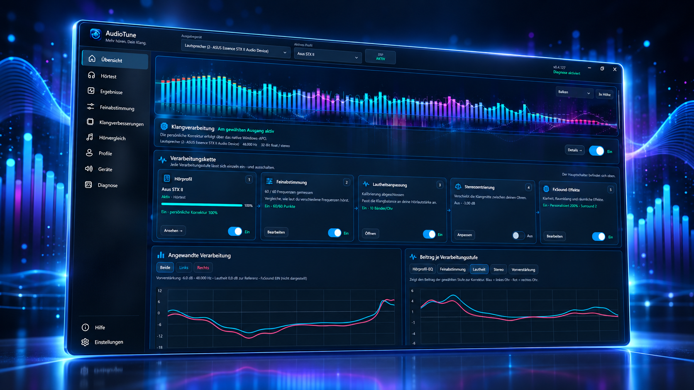

# AudioTune

**Mehr hören. Dein Klang.** Persönliche Hörkorrektur, individuell eingemessene Lautheitsanpassung und systemweite Klangverarbeitung für Windows.

**Stable Release: 0.4.127 · 13. Oktober 2026**

[**Windows-Setup herunterladen**](https://github.com/swayze-sys/AudioTune/releases/download/v0.4.127/AudioTuneSetup-0.4.127.exe) · [Versionshinweise](https://github.com/swayze-sys/AudioTune/releases/tag/v0.4.127) · [English](README.md) · [Installation und Hilfe](Documentation/CURRENT_RELEASE.md)

*AudioTune 0.4.127 — vom Projektautor bereitgestelltes Präsentationsbild mit Übersicht, Spektrum und Verarbeitungskette.*

## Die wichtigsten Neuerungen seit 0.4.18

### Oberfläche und Erklärungen

1. **Vollständige WinUI-3-Oberfläche.** Die Windows-Anwendung wurde mit durchgängiger Navigation, nativen Bedienelementen sowie blauem und rotem Design neu aufgebaut. Der Kalibrierablauf bleibt erhalten.
2. **Übersichtlichere Verarbeitungskette.** Das Dashboard zeigt Zustand und Kalibrierfortschritt aller fünf Stufen gemeinsam und führt direkt zu den passenden Einstellungen.
3. **Diagramme der angewandten Korrektur.** Gespeicherte Verarbeitung und Beiträge einzelner Stufen lassen sich getrennt für links/rechts prüfen, statt das Ergebnis nur aus Reglerstellungen abzuleiten.
4. **Drei GPU-Spektrumdarstellungen.** Balken, Neon-Kontur oder Wellenband wählen, die Höhe anpassen und Korrekturüberlagerungen betrachten.
5. **Kontextsensitive Katzenhilfe.** Passende Erklärungen und Klick-für-Klick-Anleitungen heben relevante Bedienelemente hervor. Nach dem Hörtest führen die Katzen zu Feinabstimmung, Loudness und DSP – mit ihrem gewohnten bissigen Humor.

### Systemweite Klangverarbeitung

6. **Eigenes Windows-APO.** Hörkorrektur und Effekte können nativ im Windows-Audioweg verarbeitet werden.
7. **Automatische Kompatibilitätsprüfung und Rückfall.** Die Einrichtung prüft geeignete Effektstufen, erhält unterstützte Herstellerketten und bietet Equalizer APO als Rückfall, wenn sich der native Weg nicht herstellen lässt.
8. **Native 7.1-Wiedergabe.** Die Hörkorrektur wirkt auf vorne links/rechts; die übrigen Kanäle bleiben erhalten. Es handelt sich nicht um eine Hörkalibrierung aller acht Kanäle.
9. **Sinnvoller DSP-Status bei Stille.** Eine Wiedergabepause allein macht die zuletzt bestätigte native Konfiguration nicht mehr ungültig. Erhaltene Verarbeitungskurven bleiben von frischen Live-Daten unterscheidbar.
10. **Begrenzte automatische DSP-Wiederherstellung.** Unerwartet inaktive/unbestätigte Zustände starten eine begrenzte Prüfkette. Bewusstes Ausschalten und pegelgleicher Bypass werden respektiert. Version 0.4.127 stellt zusätzlich einen gestoppten nativen Controller beim Programmstart, im Setup und vor manueller DSP-Aktivierung wieder her und erhält neuere gespeicherte Einstellungen.

### Individuelle Lautheitsanpassung

11. **Messung bei mehreren Hörpegeln.** Tonpaar-Vergleiche erstellen eine persönliche pegelabhängige Korrektur mit bis zu 90 Abgleichen für beide Ohren.
12. **Eigener Musik-Hörbereich.** Die leiseste und lauteste übliche Musikwiedergabe erfassen, damit die gemessene Korrektur zum persönlichen Lautstärkebereich passt.
13. **Steuerung über Lautstärke und Signalpegel.** Festlegen, wie Windows-Pegel und gemessenes Eingangssignal in Loudness Adaptation einfließen. Die benötigten Referenzen werden mit der Kalibrierung gespeichert.
14. **Browser-/Spotify-Lautstärke erkennen.** Unterstützte Playerregler liefern ihre Absenkung in dB. Ein ausgeblendeter Regler kann seinen validierten Pegel behalten, solange die Wiedergabe weiterläuft.
15. **Beobachtung bei geschlossener Oberfläche.** `AudioTune.PlayerObserver.exe` führt die unterstützte Playerbeobachtung in der angemeldeten Windows-Sitzung weiter.
16. **Windows-Audioereignisse nutzen.** App-Lautstärke, Stummschaltung und Wiedergabestatus verwenden Session-Benachrichtigungen. Bei Browsern bleiben ergänzende Kontrollabfragen, wenn deren Ereignisse unvollständig sind.

### Geräte und Klarheit

17. **Gespeicherte Profile pro Ausgang.** Die gewählte Gerätezuordnung merken und die vorbereitete Korrektur auf bereits eingerichteten Ausgängen auch ohne Hauptfenster verwenden.
18. **Bessere USB-/Bluetooth-Wiedererkennung.** Stabile Hardware-/Funktionskennungen helfen bei unterstützten Endpunktwechseln und erneutem Bluetooth-Pairing. Bei mehrdeutigen Geräten wird nicht geraten.
19. **Messwerte gezielt übernehmen.** Hörmessungen, Feinabstimmung, Loudness oder Stereozentrierung ausgewählt auf ein anderes Profil bzw. einen anderen Ausgang übertragen. Herkunft und ursprüngliche Daten bleiben erhalten.
20. **Optionale personalisierte Klarheit.** Profilabhängige Regler für Presence, Definition, Detail und Air ergänzen die originalen FxSound-Effekte.
21. **Überarbeitete Clarity-Pegelbegrenzung.** Ein gemeinsames Effektbudget und Lookahead schützen den Zusatzanteil der personalisierten Klarheit. Die Kontrolle auf Übersteuerung des Gesamtausgangs bleibt trotzdem nötig.

### Speichern und Aktualisieren

22. **Eine lesbar benannte Datei pro Profil.** Hörmessungen, Korrektur-Presets, die ausgewählte Korrektur und offene Loudness-Tests liegen zusammen in einer nach dem Profil benannten Datei.
23. **Fortsetzbare Tests und klare Speicherberichte.** Bestätigte Loudness-Punkte später fortsetzen. Berichte nennen die tatsächliche Datei und die im aktuellen Test gespeicherten Werte; einzelne Hörpunkt-Wiederholungen erhalten eine nicht blockierende Bestätigung.
24. **Geprüfte Sicherung vor der Zusammenführung.** Getrennte Dateien werden erst nach verifizierter Sicherung zusammengeführt. Import, Export, Sicherungskopie und Wiederherstellung übernehmen den vollständigen Profilinhalt. Leere Standards verdrängen nicht mehr automatisch eine gemessene Korrektur.
25. **Eine AudioTune-Installation.** Erkannte alte WPF-/AppData-Versionen werden nach `C:\Program Files\AudioTune` überführt. Das Setup wartet auf das tatsächliche Observer-Prozessende und erkennt Reste einer teilweise entfernten Altinstallation.
26. **Keine mitgelieferte .NET-Runtime.** Das Setup setzt die systemweite .NET 10 Desktop Runtime x64 voraus, prüft das Paket und entfernt erkannte alte private Runtimes aus dem Programmordner.
27. **Stable-Updates aus der Anwendung prüfen.** Den öffentlichen Stable-Kanal direkt aus AudioTune prüfen, auf Wunsch zusätzlich über eine geplante Benutzeraufgabe. Der Installer muss nicht mehr zwischen Repository-Dateien gesucht werden.

## Was AudioTune macht

Jedes Ohr von **30 Hz bis 18 kHz** messen, das Ergebnis mit Feinabstimmung verfeinern, Original und Korrektur im Hörvergleich prüfen und die Korrektur dauerhaft auf einen ausgewählten Ausgang anwenden. Die Korrekturintensität reicht von **0–200 %**, während die Rohmessungen erhalten bleiben. Stereo-Schutz und eine ausschließlich absenkende Stereozentrierung helfen, die Links-/Rechts-Balance zu erhalten.

Die originale FxSound-Engine bietet Klarheit, Atmosphäre, Raumklang, Dynamik und Bass. AudioTune ist kein offizielles FxSound-Produkt.

> AudioTune ist kein medizinisches Audiometer. Die Hörmessungen sind relative digitale Pegel in **dBFS**, keine kalibrierten dB-HL-Werte oder medizinische Diagnose. „Stable“ bezeichnet den regulären Veröffentlichungskanal, keine klinische Validierung oder garantierte Unterstützung jedes Audiotreibers.

## Installieren oder aktualisieren

1. **Windows 10 ab Build 19041 oder Windows 11, x64** verwenden.
2. Falls erforderlich, die **Microsoft .NET 10 Desktop Runtime, x64** installieren. [Microsoft-Download](https://dotnet.microsoft.com/de-de/download/dotnet/10.0). Dieses Setup **enthält und installiert keine .NET-Runtimes**. Zur Nutzung ist kein .NET-SDK nötig.
3. `AudioTuneSetup-0.4.127.exe` ausführen. AudioTune wird unter `C:\Program Files\AudioTune\AudioTune.exe` installiert.
4. Unter **Geräte** den gewünschten Ausgang wählen und die Audio-Einrichtung abschließen. Wenn das native APO funktioniert, ist Equalizer APO optional; eine vorhandene Installation kann als Rückfall dienen.

Das Setup löst erkannte alte WPF-/AppData-Installationen ab, erhält Nutzerdaten und erstellt eine Migrationssicherung. Es wartet auf den Abschluss des Hintergrundbeobachters, bevor alte Programm-DLLs entfernt werden. Zum Aktivieren vorbereiteter nativer Audiokomponenten kann ein regulärer Windows-Neustart nötig sein.

Deine Daten bleiben unter `%LOCALAPPDATA%\AudioTune`. Pro Hörprofil liegt eine lesbar benannte Datei in `Profiles`; Sicherungen und Migrationskopien liegen unter `Backups`. Rohmessung und Korrektur bleiben getrennte Datenbereiche innerhalb dieser Datei.

## Kompatibilität und Hilfe

- Der native Wiedergabeweg unterstützt Stereo und 7.1. Bei 7.1 wirkt die persönliche Hörkorrektur auf das vordere Links-/Rechts-Paar; die übrigen Kanäle bleiben erhalten. Es handelt sich nicht um eine Hörkalibrierung aller acht Kanäle.
- Hersteller-APOs, exklusive/raw Wiedergabe und einzelne Treiber können die Systemeffekte beeinflussen. Die Einrichtung prüft Kompatibilität und bietet einen Rückfall; eine Unterstützung jeder Hardware wird nicht behauptet.
- Die Browser-/Spotify-Erkennung hängt davon ab, ob der Player einen lesbaren Regler bereitstellt. Windows-App-Pegel bleiben auch ohne lesbaren Playerregler beobachtbar.
- Bitdefender hat einzelne unsignierte AudioTune-Installer/Helfer über seine Verhaltenserkennung gemeldet. Frühere Rückmeldungen zu sauberen Dateien haben nicht jede spätere Meldung gelöst; eine allgemeine Virenschutzfreigabe wird nicht behauptet.

Bei Problemen bitte AudioTune-Version, Ausgabegerät, Windows-Kanalkonfiguration und die relevante Diagnosemeldung in einem [GitHub-Issue](https://github.com/swayze-sys/AudioTune/issues) angeben. Profildateien enthalten persönliche Hörmessungen und sollten nur bewusst geteilt werden.

## Release und Quellstand

Als Release-Datei wird das Windows-Setup angeboten. Der aktuelle WinUI-Entwicklungsquellcode bleibt privat. Die bisher öffentlich vorhandenen WPF-Quellen, die von GitHub automatisch erzeugten Quellcodearchive und älteren Dokumente beschreiben die historische Version 0.4.18; daraus lässt sich die aktuelle WinUI-Anwendung nicht bauen. Aktuelle Installationshinweise, Datenübernahme und Grenzen stehen unter [Aktueller Release](Documentation/CURRENT_RELEASE.md).

AudioTune enthält FxSound-Code unter AGPL-3.0. Siehe [LICENSE](LICENSE) und [Drittanbieterhinweise](THIRD_PARTY_NOTICES.md).
