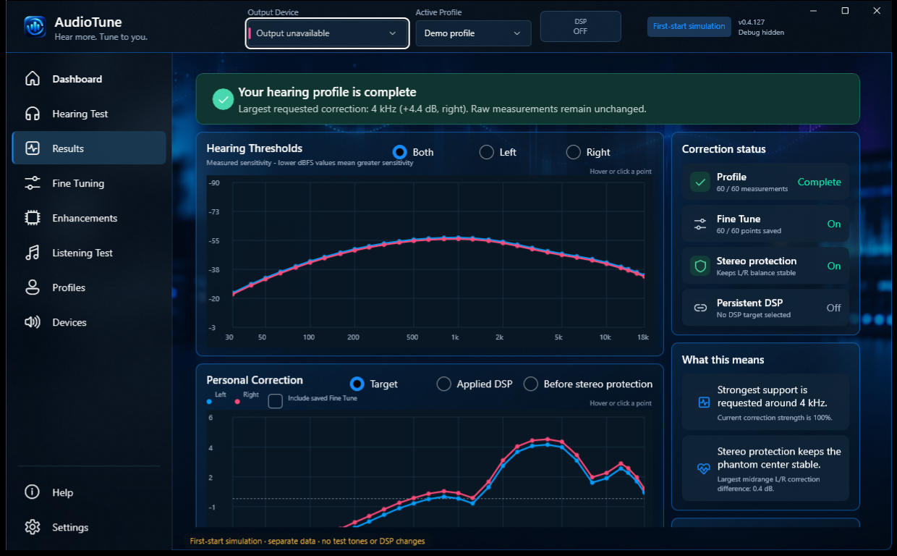

# AudioTune

**Hear more. Tune to you.** Personal hearing correction, individually calibrated Loudness Adaptation and system-wide sound processing for Windows.

**Stable release: 0.4.127 · 13 October 2026**

[**Download Windows setup**](https://github.com/swayze-sys/AudioTune/releases/download/v0.4.127/AudioTuneSetup-0.4.127.exe) · [Release notes](https://github.com/swayze-sys/AudioTune/releases/tag/v0.4.127) · [Deutsch](README.de.md) · [Installation and support](Documentation/CURRENT_RELEASE.md)

*Actual 0.4.127 interface with synthetic demo measurements. The screenshot contains no personal hearing data; audio playback and system DSP changes are disabled in this demonstration.*

## The important changes since 0.4.18

### Interface and explanations

1. **A complete WinUI 3 interface.** The Windows application has been rebuilt with consistent navigation, native controls and blue/red themes while preserving the calibration workflow.
2. **A clearer processing dashboard.** The five processing stages show their state and calibration progress together, with direct access to the relevant settings.
3. **Applied-correction graphs.** Inspect the saved processing response and the contribution of individual stages, with separate left/right views instead of inferring the result from sliders alone.
4. **Three GPU spectrum styles.** Choose bars, a neon contour or a ribbon, with adjustable display height and visual correction overlays.
5. **Contextual cat guides.** Page-specific help and step-by-step setup instructions highlight the relevant controls. Completed hearing tests lead into Fine Tune, Loudness and DSP setup, with the cats' usual dry humor.

### System-wide audio processing

6. **AudioTune's own Windows APO.** Native system-wide processing can run the hearing correction and effects directly in the Windows audio path.
7. **Automatic native-route checks and fallback.** Setup checks suitable endpoint stages, preserves supported manufacturer chains and offers Equalizer APO fallback when the native route cannot be established.
8. **Native 7.1 playback compatibility.** The hearing correction acts on front left/right while preserving the remaining channels. This is not eight-channel hearing calibration.
9. **A useful idle DSP state.** Pausing playback no longer alone invalidates the last confirmed native configuration; retained processing curves remain distinguishable from fresh live telemetry.
10. **Bounded DSP recovery.** Unexpected inactive/unconfirmed states trigger a limited recovery sequence. A deliberate off or level-matched bypass choice remains respected. Version 0.4.127 also recovers a stopped native controller at app startup, during setup and before manual DSP activation, retaining newer saved settings.

### Individual Loudness Adaptation

11. **Calibration at several listening levels.** Paired-tone comparisons build an individual level-dependent correction, with up to 90 matches across both ears.
12. **Personal music listening limits.** Capture your quietest and loudest usual music levels so the measured correction follows your own listening range.
13. **Volume and signal-level control modes.** Choose how Windows level and the measured input signal contribute to Loudness Adaptation; the required references are stored with the calibration.
14. **Browser/Spotify player-volume detection.** Supported player controls contribute their attenuation in dB. A hidden control can retain its validated level while playback continues.
15. **Observation after closing the main window.** `AudioTune.PlayerObserver.exe` keeps supported player-volume observation running in the logged-in session.
16. **Windows audio-session events.** App volume, mute and playback-state changes use session notifications; browsers retain occasional safety scans where accessibility events are incomplete.

### Devices and clarity

17. **Saved profiles per output.** Remember the chosen profile for a device and keep the prepared correction on already configured outputs even without the main window.
18. **Improved USB/Bluetooth recognition.** Stable hardware/function identities help recover device assignments after supported endpoint changes or Bluetooth re-pairing; ambiguous devices are not guessed.
19. **Selective measurement transfer.** Reuse selected hearing, Fine Tune, Loudness or stereo-centering measurements for another profile/output, retaining transfer provenance and the original source data.
20. **Optional Personalized Clarity.** Profile-aware Presence, Definition, Detail and Air controls complement the original FxSound effects.
21. **Reworked Clarity peak handling.** The personalized effect uses a shared effect budget and lookahead protection for its added signal. This does not remove the need to monitor overall output clipping.

### Saving and updating

22. **One readable document per profile.** Hearing measurements, correction presets, the selected preset and unfinished Loudness tests share a file named after the profile.
23. **Resumable tests and transparent save reports.** Confirmed Loudness points can be resumed later. Reports identify the actual file and values saved during the current test; individual hearing-point retakes use a non-blocking confirmation.
24. **Verified migration backups.** Existing separate files are consolidated only after backup verification. Import, export, Save Copy and restore carry the complete profile contents; unused default presets no longer displace a measured correction automatically.
25. **One AudioTune installation.** Recognized WPF/AppData installations are migrated to `C:\Program Files\AudioTune`. The installer waits for the observer's actual exit and can resume cleanup after a partial uninstall.
26. **No bundled .NET runtime.** The installer requires the system-wide .NET 10 Desktop Runtime x64, checks the payload and removes recognized stale private runtimes from the application folder.
27. **Stable-release update checks.** Check the public stable feed from the app, with an optional per-user scheduled check. New releases no longer require browsing repository files to find an installer.

## What AudioTune does

Measure each ear from **30 Hz to 18 kHz**, refine the result with Fine Tune, compare original/corrected playback and apply a persistent correction to a chosen output. Adjust correction intensity from **0–200%** while retaining the raw measurements. Stereo-image protection and attenuation-only centering help preserve the left/right balance.

The original FxSound engine provides Clarity, Ambience, Surround, Dynamic Boost and Bass. AudioTune is not affiliated with FxSound.

> AudioTune is not a medical audiometer. Hearing measurements are relative digital levels in **dBFS**, not calibrated dB HL or a medical diagnosis. “Stable” identifies the regular release channel, not clinical validation or guaranteed compatibility with every audio driver.

## Install or update

1. Use **Windows 10 build 19041 or newer / Windows 11, x64**.
2. Install the **Microsoft .NET 10 Desktop Runtime, x64** if needed. [Microsoft download](https://dotnet.microsoft.com/en-us/download/dotnet/10.0). This setup **does not bundle or install .NET runtimes**; the .NET SDK is not needed to use AudioTune.
3. Run `AudioTuneSetup-0.4.127.exe`. AudioTune installs as `C:\Program Files\AudioTune\AudioTune.exe`.
4. Open **Devices**, select the intended output and complete its audio setup. Equalizer APO is optional when the native APO works; an existing Equalizer APO installation can serve as the fallback.

The installer retires recognized older WPF and AppData installations, preserves user data and creates a migration backup. It waits for AudioTune's observer to finish before removing old program DLLs. A regular Windows restart may be required to activate prepared native audio components.

Your data remains under `%LOCALAPPDATA%\AudioTune`. Each profile uses one readable document in `Profiles`; previous files and migrations are backed up under `Backups`. Raw measurements and tuning remain separate sections inside the document.

## Compatibility and support

- Native playback supports stereo and 7.1 layouts. In 7.1, the personal hearing correction acts on the front left/right pair; other channels are preserved. This is not an eight-channel hearing calibration.
- Manufacturer APOs, exclusive/raw playback and individual drivers can affect whether system effects are processed. Native setup includes compatibility checks and fallback; universal hardware support is not claimed.
- Browser/Spotify control detection depends on the player exposing a usable control. Windows-session observation remains available when a player control cannot be read.
- Bitdefender has reported some unsigned AudioTune installers/helpers through behavioral detection. Earlier clean-file feedback did not resolve every later behavior alert; a general antivirus clearance is not claimed.

For a problem, include the AudioTune version, output device, Windows channel layout and the relevant diagnostic message in a [GitHub issue](https://github.com/swayze-sys/AudioTune/issues). Do not post personal profile files unless you intend to share their hearing measurements.

## Release and source information

The downloadable release asset is the Windows setup. Current WinUI development source remains private. The existing WPF source, GitHub's automatically generated source archives and older documents in this repository describe the historical 0.4.18 implementation; they do not build the current WinUI application. Current installation, data migration and limitations are documented in [Current release](Documentation/CURRENT_RELEASE.md).

AudioTune includes AGPL-3.0 FxSound code. See [LICENSE](LICENSE) and [third-party notices](THIRD_PARTY_NOTICES.md).
